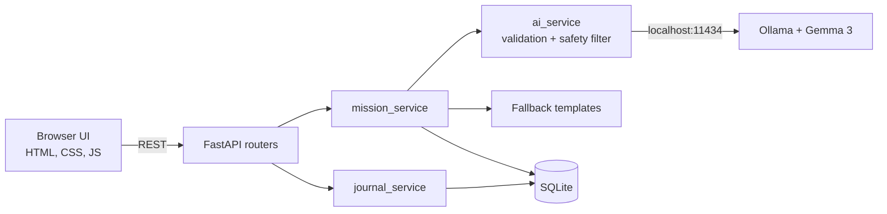

# 🌲 TrailMate AI

**Your open-source AI nature companion.** *Read the mission. Lock your phone. Go be here.*

Built for the Hacktoberfest 2026 DEV Open-Source AI Challenge, Week 1: **"Touch Grass."**

> **Demo:** TODO add link · **Article:** TODO add DEV post link

TrailMate AI turns "I should go outside" into a small, personal nature mission written by Google's **Gemma 3** running locally through **Ollama**. You read it once, lock your phone, go outside, then record what you noticed in a private nature journal.

## Why

"Go outside more" is easy advice and hard to follow. The hurdle is often small: *what do I do with 20 free minutes in a park?* Most apps add another screen, account or cloud service. TrailMate removes the hurdle, then gets out of your way.

## Features

- **AI mission generator:** choose time (10-60 min), interests, place and difficulty. Get a title, description, 3-5 tasks and a phone-away reminder.
- **Honest labels:** every mission shows whether it was *AI-written by gemma3:4b* or a *built-in template*. A template is never passed off as AI.
- **Safe fallback:** if Ollama or the model is missing, times out, or returns bad or unsafe output, a hand-written template is used. The app never crashes.
- **Mission mode:** checklist, progress bar, a calm "Go outside" screen, and an optional timer that never completes a mission by itself.
- **Nature journal:** notes with a mood, optionally linked to a mission, stored in SQLite.
- **Dashboard:** missions, outdoor minutes, journal entries. Everything is labelled **self-reported**; no GPS or sensors are used.
- **Private:** no login, analytics or tracking. The page makes no external requests (enforced by a Content-Security-Policy).

## Screenshots

> **TODO:** add real screenshots to `docs/screenshots/` (home, mission form, mission, "Go outside" screen, journal, mobile), then embed with ``.

## Architecture



Routers handle HTTP, services hold logic, `database.py` owns SQLite. More in [docs/ARCHITECTURE.md](docs/ARCHITECTURE.md).

**Stack:** Python 3.10+, FastAPI, Uvicorn, httpx, SQLite (standard library), vanilla HTML/CSS/JS, pytest.

## Install (Windows, PowerShell)

Requires Python 3.10+ (with the `py` launcher) and VS Code.

```powershell
cd $HOME\Documents
git clone https://github.com/<your-username>/TrailMate-AI.git
cd TrailMate-AI
py -m venv .venv
.\.venv\Scripts\Activate.ps1
python -m pip install -r requirements.txt
```

**Local AI (recommended).** Install Ollama from <https://ollama.com/download>, reopen the terminal, then:

```powershell
ollama pull gemma3:4b
ollama list
```

The first download needs internet and several GB. After that, everything runs offline. Without Ollama, the app still works with built-in missions.

## Run

```powershell
python -m uvicorn app.main:app --reload
```

Open <http://127.0.0.1:8000>. The database `data/trailmate.db` is created automatically. The header pill shows whether local AI is ready.

## Test

```powershell
python -m pytest -v
```

No Ollama, Gemma or internet needed. Tests use a temporary database and mock the AI layer.

## Configuration (optional)

`Copy-Item .env.example .env`, then edit:

| Variable | Default |
|---|---|
| `TRAILMATE_OLLAMA_URL` | `http://localhost:11434` |
| `TRAILMATE_OLLAMA_MODEL` | `gemma3:4b` |
| `TRAILMATE_OLLAMA_TIMEOUT` | `90` (seconds) |
| `TRAILMATE_DB_PATH` | `data/trailmate.db` |

## API

Interactive docs at <http://127.0.0.1:8000/docs> (loads from a CDN, so needs internet).

| Method | Path | Description |
|---|---|---|
| GET | `/api/health` | Status, Ollama and model availability |
| POST | `/api/missions` | Generate (AI or fallback) and save a mission |
| GET | `/api/missions` | Recent missions |
| GET | `/api/missions/{id}` | One mission |
| PATCH | `/api/missions/{id}/start` | Mark started |
| PATCH | `/api/missions/{id}/complete` | Record self-reported completion |
| POST | `/api/journal` | Save an entry |
| GET | `/api/journal` | List entries |
| DELETE | `/api/journal/{id}` | Delete an entry |
| GET | `/api/stats` | Progress statistics |

Errors: `404` unknown id, `422` invalid input, `500` database failure.

Example:

```json
POST /api/missions
{ "duration_minutes": 20, "interests": ["plants", "walking"],
  "environment": "nearby park", "difficulty": "easy" }
```

The response includes `source` (`"ai"` or `"fallback"`) and `model_name` (only for AI).

## Privacy

Data stays in a local SQLite file. Missions are generated on your machine. No analytics, no accounts, no third-party requests. Browser `localStorage` only remembers the open mission and ticked tasks. It is meant for one person on their own computer; don't expose it to the internet.

## Why open-weight, local AI

A nature journal reveals where you go and how you feel, so it shouldn't need a cloud service. A local open-weight model means no account, no API key, no per-request cost, offline use, and a model anyone can inspect or swap. Gemma 3 (4B) is small enough for a laptop, and Ollama makes running it one install.

## Results

> **TODO (don't invent numbers):**
> - `python -m pytest -v` result: _paste the real summary line_
> - Manual Gemma check: _how many missions you tried, how many were AI vs fallback, quality notes, generation time on your machine_
> - Real outdoor test: _see the DEV article_

## Limitations

- No live weather, maps, trail conditions or wildlife data. Check conditions yourself and stay somewhere safe, public and legal.
- Progress is self-reported; the app can't verify you went outside.
- A 4B model can be repetitive or odd. Validation catches malformed output, not mediocre output.
- The safety filter is a keyword check: it can reject harmless text and miss subtle problems. Never eat wild plants or approach wildlife.
- English only, single user, no authentication. Tests use mocks, so real model quality isn't covered.

## Roadmap

Journal export · opt-in weather · richer mission history · PWA/offline install · optional plant and bird ID with an open vision model

## Troubleshooting

| Problem | Fix |
|---|---|
| Venv activation blocked | `Set-ExecutionPolicy -Scope CurrentUser -ExecutionPolicy RemoteSigned`, then activate again |
| `py` not recognized | Use `python -m venv .venv`, or reinstall Python with "Add to PATH" and "py launcher" |
| `ModuleNotFoundError` | Activate the venv, run from the project root, then `python -m pip install -r requirements.txt` |
| `SyntaxError` after pasting | A file was cut off. Run `python -m compileall -q app tests` and replace the named file |
| Port 8000 busy | `python -m uvicorn app.main:app --reload --port 8001` |
| "Ollama not detected" | Start Ollama from the Start menu or run `ollama serve`. Missions use the fallback meanwhile |
| "Model not installed" | `ollama pull gemma3:4b` |
| First mission slow | The model is loading. Raise `TRAILMATE_OLLAMA_TIMEOUT` in `.env` |
| Page looks old | Hard refresh with `Ctrl+F5` |

## Contributing and license

See [CONTRIBUTING.md](CONTRIBUTING.md). Released under the [MIT License](LICENSE).
