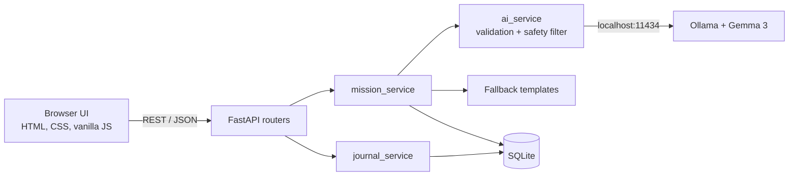

# TrailMate AI

**Your open-source AI nature companion.**
*Read the mission. Lock your phone. Go be here.*

Built for the Hacktoberfest 2026 DEV Open-Source AI Challenge, Week 1: **"Touch Grass."**

TrailMate AI turns "I should go outside" into a small, personal nature mission written by an open-weight AI model (Google's Gemma 3) running on your own computer. You read it once, put the phone away, go outside, and come back to record what you noticed in a local nature journal.

## Table of contents

- [Problem](#problem) · [Solution](#solution) · [Features](#features) · [Screenshots](#screenshots)
- [Architecture](#architecture) · [Tech stack](#technology-stack)
- [Install on Windows](#installation-windows) · [Run](#run-the-app) · [Test](#run-the-tests)
- [API](#api-documentation) · [Privacy](#privacy-and-offline-behaviour) · [Why open-source AI](#why-open-weight-ai)
- [Limitations](#limitations) · [Roadmap](#roadmap) · [Troubleshooting](#troubleshooting) · [Contributing](#contributing) · [License](#license)

## Problem

Many of us spend most of the day looking at screens. "Go outside more" is easy advice and hard to act on, because deciding *what to do* with 20 free minutes in a park is itself a small hurdle. Most apps that try to help add yet another screen, an account, or a data-hungry cloud service.

## Solution

TrailMate removes the hurdle. You choose your time, interests, place and difficulty. A local model writes a short, safe, concrete mission with three to five tasks. The app then does the opposite of most apps: it encourages you to **stop looking at it**. A dark "Go outside" screen tells you to lock your phone, and nothing is marked complete just because a timer ran out. You say when you're done, and only then do you open the journal.

## Features

- **AI mission generator.** Time (10/20/30/45/60 min), interests (nature discovery, bird watching, plants, mindfulness, photography, walking), environment (garden, campus, nearby park, or your own description), difficulty (easy, medium, adventurous).
- **Honest labelling.** Every mission is marked either *AI-written by gemma3:4b on your device* or *Built-in template, not AI-generated*.
- **Safe fallback.** If Ollama or the model is unavailable, or its output is malformed or fails the safety check, hand-written templates are used. The app never crashes.
- **Outdoor mission mode.** Task checklist, progress bar, start and completion controls, an optional countdown timer, encouraging messages and a "Go outside" screen.
- **Nature journal.** Notes with a mood, optionally linked to a mission, saved in SQLite.
- **Progress dashboard.** Missions created and completed, outdoor minutes, journal entries and recent activity. Clearly labelled **self-reported**: no GPS or sensors are used.
- **Private by design.** No login, no analytics, no external requests from the page.
- **Accessible UI.** Keyboard navigation, visible focus rings, labelled forms, reduced-motion support and a responsive layout.

## Screenshots

> **TODO:** add real screenshots after running the app. Suggested files in `docs/screenshots/`:
>
> | File | Shows |
> |---|---|
> | `01-home.png` | Hero and progress statistics |
> | `02-mission-form.png` | Mission configuration form |
> | `03-mission.png` | Generated mission with checklist and the AI/template badge |
> | `04-go-outside.png` | The "Go outside" screen |
> | `05-journal.png` | Nature journal |
> | `06-mobile.png` | Phone-width layout |
>
> Then embed them here with ``.

## Architecture



Routers handle HTTP only, services hold the logic, and `database.py` owns SQLite. Details are in [docs/ARCHITECTURE.md](docs/ARCHITECTURE.md).

## Technology stack

| Piece | Choice |
|---|---|
| Backend | Python 3.10+, FastAPI, Uvicorn |
| AI | Google Gemma 3 (`gemma3:4b`) through Ollama, running locally |
| Database | SQLite (Python standard library) |
| HTTP client | httpx (talks to Ollama) |
| Frontend | HTML5, CSS3, vanilla JavaScript (no frameworks, no CDNs) |
| Tests | pytest and FastAPI TestClient |

## Installation (Windows)

You need **Windows 10/11**, **Python 3.10 or newer** (from python.org; tick "Add python.exe to PATH" and keep the `py` launcher), **VS Code**, and **Git** (optional).

Open VS Code, then **Terminal → New Terminal** (PowerShell).

### 1. Get the project

```powershell
cd $HOME\Documents
git clone https://github.com/<your-username>/TrailMate-AI.git
cd TrailMate-AI
code .
```

(No Git? Download the ZIP from GitHub, extract it to `Documents\TrailMate-AI`, then run `cd $HOME\Documents\TrailMate-AI`.)

### 2. Create and activate a virtual environment

```powershell
py -m venv .venv
.\.venv\Scripts\Activate.ps1
```

Your prompt should now start with `(.venv)`. If activation is blocked, see [Troubleshooting](#troubleshooting).

### 3. Install dependencies

```powershell
python -m pip install --upgrade pip
python -m pip install -r requirements.txt
```

### 4. Install Ollama and download Gemma (optional but recommended)

The app works without this using built-in missions, but the AI is the point.

1. Download and install Ollama for Windows from <https://ollama.com/download>.
2. **Close and reopen the VS Code terminal**, then re-activate the venv (`.\.venv\Scripts\Activate.ps1`).
3. Verify and download the model. **The first download needs internet** and several gigabytes of disk space. After that, generation is local:

```powershell
ollama --version
ollama pull gemma3:4b
ollama list
```

`ollama list` should show `gemma3:4b`. To use a different model or address, copy the settings file with `Copy-Item .env.example .env` and edit `.env`.

## Run the app

```powershell
python -m uvicorn app.main:app --reload
```

Open **<http://127.0.0.1:8000>** in your browser. The first mission can take up to a minute while the model loads into memory. Stop the server with `Ctrl+C`. The database `data/trailmate.db` is created automatically on first start.

## Run the tests

```powershell
python -m pytest -v
```

The tests need no Ollama, no Gemma and no internet connection. They use a temporary database and mock the AI layer.

## API documentation

Interactive docs: <http://127.0.0.1:8000/docs> (this page loads its UI from a CDN, so it needs internet; the app itself does not).

| Method | Path | Description | Success |
|---|---|---|---|
| GET | `/` | Serves the frontend | 200 |
| GET | `/api/health` | App status and whether Ollama and the model are available | 200 |
| POST | `/api/missions` | Generate (AI or fallback) and save a mission | 201 |
| GET | `/api/missions?limit=20` | Recent missions, newest first | 200 |
| GET | `/api/missions/{id}` | One mission | 200 |
| PATCH | `/api/missions/{id}/start` | Mark a mission as started | 200 |
| PATCH | `/api/missions/{id}/complete` | Record self-reported completion | 200 |
| POST | `/api/journal` | Save a journal entry | 201 |
| GET | `/api/journal?limit=100&mission_id=` | List entries, newest first | 200 |
| DELETE | `/api/journal/{id}` | Delete an entry | 204 |
| GET | `/api/stats` | Progress statistics | 200 |

Errors: `404` for an unknown mission or entry, `422` for invalid input (the response explains which field), `500` for a database failure.

**Create a mission**

```json
POST /api/missions
{
  "duration_minutes": 20,
  "interests": ["plants", "walking"],
  "environment": "nearby park",
  "difficulty": "easy"
}
```

The response is a mission object with `id`, `title`, `description`, `duration_minutes`, `difficulty`, `interests`, `environment`, `tasks`, `phone_reminder`, `source` (`"ai"` or `"fallback"`), `model_name` (only when `source` is `"ai"`), `status` (`created`, `started`, `completed`), `completed_task_count`, `created_at`, `started_at` and `completed_at`.

**Complete a mission**

```json
PATCH /api/missions/1/complete
{ "completed_task_count": 3 }
```

The count must be between 1 and the number of tasks. Repeating the request changes nothing.

**Save a journal entry**

```json
POST /api/journal
{ "content": "Heard a woodpecker.", "mood": "calm", "mission_id": 1 }
```

`mood` is one of `calm, happy, energized, curious, grateful, tired, neutral`. `mission_id` is optional. `content` is 1-2000 characters.

## Privacy and offline behaviour

- No login, no analytics, no tracking.
- The journal and missions live in a SQLite file on your computer (`data/trailmate.db`, ignored by Git).
- Missions are generated by Gemma on your own machine through Ollama. No data is sent to a cloud AI service.
- The page loads no remote fonts, images, scripts or APIs, and a Content-Security-Policy enforces this in the browser.
- Downloading the model the first time needs internet. After that, TrailMate works offline.
- The browser's `localStorage` stores only which mission is open and which tasks you ticked.

## Why open-weight AI

For a nature journal, privacy is the point: your reflections and the places you go should not need to leave your computer. An open-weight model that runs locally gives you that, works without an account or API key, costs nothing per request, and can be inspected, swapped or improved by anyone. Gemma 3 at 4B parameters is small enough for an ordinary laptop, and Ollama makes running it a one-line install.

## Limitations

- TrailMate has **no live weather, maps, trail conditions or wildlife data**, and the model is told never to claim any. Check conditions yourself and stay somewhere safe, public and legal.
- Progress is **self-reported**. The app cannot know whether you went outside.
- Mission quality depends on the local model. A 4B model can be repetitive or occasionally odd.
- The safety filter is a conservative keyword check. It can reject harmless text and is not a guarantee. Use your own judgement outdoors.
- Never eat wild plants or mushrooms, never approach or feed wildlife, and never enter restricted places, whatever any mission says.
- Single-user, local only. There is no authentication, so do not expose it to the internet.
- Tests run on mocks. Real model behaviour is not covered by the automated tests. **TODO:** record your own manual evaluation here.

## Roadmap

- Journal export (Markdown or JSON)
- Optional real weather lookup (opt-in, clearly labelled as a network feature)
- Richer mission history and filters
- PWA install and offline caching
- Optional plant or bird identification with an open vision model
- More languages for missions

## Troubleshooting

**"running scripts is disabled on this system" when activating the venv**

```powershell
Set-ExecutionPolicy -Scope CurrentUser -ExecutionPolicy RemoteSigned
.\.venv\Scripts\Activate.ps1
```

Answer `Y` if asked. Or skip activation and call the venv's Python directly: `.\.venv\Scripts\python.exe -m uvicorn app.main:app --reload`.

**`py` is not recognized**

Try `python --version`. If that also fails, reinstall Python from python.org and tick "Add python.exe to PATH" and "py launcher". Then close and reopen VS Code. If `python` works, use `python -m venv .venv` instead of `py -m venv .venv`.

**`ModuleNotFoundError` (fastapi, httpx, pytest, app)**

You are probably not in the venv or not in the project folder. Check that the prompt shows `(.venv)`, run `cd $HOME\Documents\TrailMate-AI`, then `python -m pip install -r requirements.txt`. Always start the server from the project root.

**Port 8000 is already in use**

Use another port:

```powershell
python -m uvicorn app.main:app --reload --port 8001
```

Then open <http://127.0.0.1:8001>. Or find and stop the old process:

```powershell
netstat -ano | findstr :8000
taskkill /PID <the number in the last column> /F
```

**"Ollama not detected" or every mission says "Built-in template"**

That is the fallback working as designed. To use the AI:

```powershell
ollama --version
Invoke-RestMethod http://localhost:11434/api/tags
```

- `ollama` not recognized: close and reopen the terminal after installing, or reinstall Ollama.
- The second command fails: start Ollama from the Start menu (it lives in the system tray), or run `ollama serve` in a separate terminal. If `ollama serve` says the address is already in use, it is already running.
- "Model not installed" in the app: `ollama pull gemma3:4b`.
- The server log line `Using fallback mission: ...` tells you the exact reason.
- A very old Ollama may not support structured JSON output. Update it from ollama.com.

**The first mission is slow**

The model loads into memory on the first request. If it exceeds the timeout, raise `TRAILMATE_OLLAMA_TIMEOUT` in `.env`.

**The page looks outdated after an update**

Hard refresh with `Ctrl+F5`.

## Contributing

Contributions are welcome. See [CONTRIBUTING.md](CONTRIBUTING.md).

## License

MIT. See [LICENSE](LICENSE).