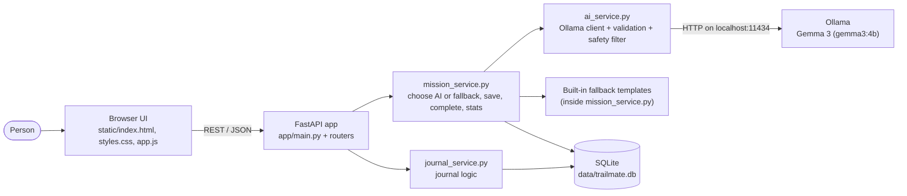

# TrailMate AI Architecture

TrailMate AI is a small, local-first web app. A static frontend talks to a FastAPI backend over REST. The backend stores everything in SQLite and asks a local Gemma model (through Ollama) to write missions, falling back to hand-written templates when the model is unavailable.

## System diagram



## Layers and responsibilities

| Layer | Files | Responsibility |
|---|---|---|
| Routing | `app/routers/*.py`, `app/main.py` | Parse HTTP, validate with Pydantic, map errors to status codes. No business logic. |
| Business logic | `app/services/mission_service.py`, `journal_service.py` | Decide AI vs fallback, enforce completion rules, compute stats. |
| AI integration | `app/services/ai_service.py` | Talk to Ollama, request structured JSON, validate output, run the safety filter. |
| Data access | `app/database.py`, `app/models.py` | SQLite connections, schema creation, parameterized SQL only. |
| Contract | `app/schemas.py` | The JSON shapes shared by the API and the frontend. Also validates AI output. |
| Frontend | `static/` | Single page, vanilla JS, no external requests. |

## Mission generation flow

1. The browser sends `POST /api/missions` with duration, interests, environment and difficulty.
2. `mission_service.create_mission` calls `ai_service.generate_mission`.
3. `ai_service` sends a chat request to Ollama with a JSON-schema `format`, a system prompt that forbids unsafe suggestions and invented live data, and a timeout.
4. The reply is parsed and validated against `GeneratedMission` (3-5 tasks, length limits), then screened by the safety filter.
5. On success the mission is saved with `source = "ai"` and the model name. On any failure (`AIGenerationError`) a built-in template mission is saved with `source = "fallback"` and no model name.
6. The UI reads `source` and shows either "AI-written by gemma3:4b" or "Built-in template, not AI-generated".

## Completion and honesty rules

- A mission is completed only by an explicit `PATCH /api/missions/{id}/complete` request. The optional countdown timer never calls it.
- The server requires 1 to N completed tasks (N = number of tasks). Repeating the call changes nothing, so statistics cannot be double counted.
- All activity is self-reported. `verified_outdoor_minutes` is always 0, and the API says why. No GPS or sensor data is read.

## Data model

```text
missions(id, title, description, duration_minutes, difficulty, interests[json], environment,
         tasks[json], phone_reminder, source['ai'|'fallback'], model_name, status['created'|'started'|'completed'],
         completed_task_count, created_at, started_at, completed_at)

journal_entries(id, mission_id -> missions.id (ON DELETE SET NULL), content, mood, created_at)
```

Timestamps are stored as UTC ISO strings ending in `Z`. The browser converts them to the local time zone for display.

## Key decisions

- **SQLite via the standard library.** No ORM means fewer dependencies and simple, parameterized SQL.
- **Plain `def` routes.** FastAPI runs them in a thread pool, so a slow, blocking AI call does not freeze the server.
- **AI output is untrusted.** It is schema-validated and safety-screened before it is stored, and invalid output triggers the fallback instead of an error.
- **Strict Content-Security-Policy.** The app can only load resources from itself, which enforces the "no external requests" promise in the browser. The built-in `/docs` page is exempt because it loads from a CDN.
- **No inline scripts, `textContent` only.** User and model text is never inserted as HTML.
- **Tests never need Ollama.** The AI layer is replaced or its HTTP calls are faked.

## Known limits

- The safety filter is a conservative keyword check, so it can reject harmless text (for example "never eat wild plants") and can miss subtle unsafe advice. It is a safeguard, not a guarantee.
- Gemma 3 4B output quality varies. Weaker answers fall back to templates only when they are malformed or fail validation, not when they are merely mediocre.
- No authentication: the app is designed for one person on their own computer. Do not expose it to the internet.